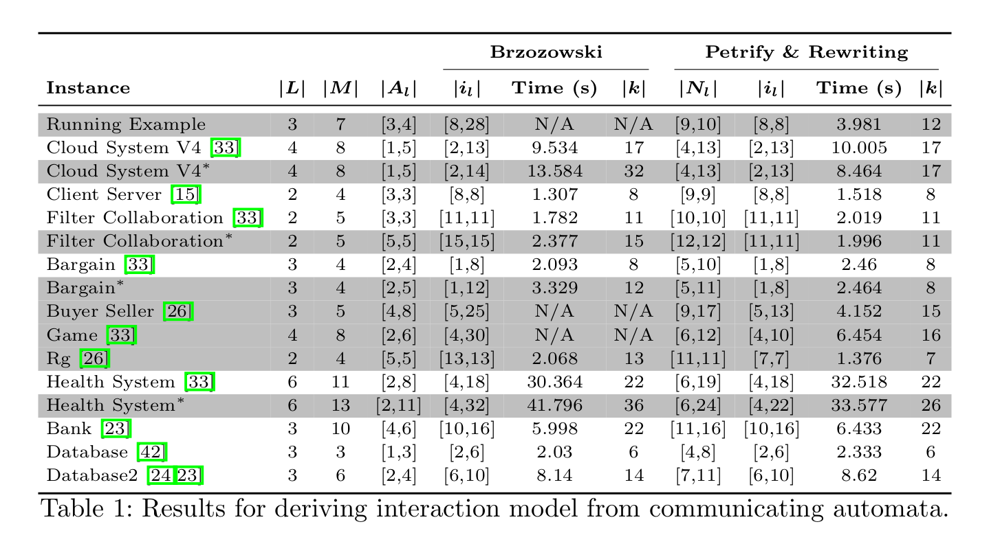
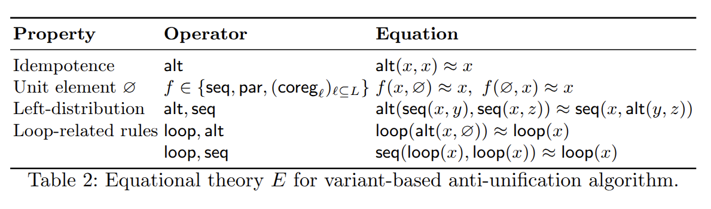

# Benchmarking of the composition of communicating automata

For selected systems of communicating automata, compose them into a global interaction using two techniqes:

- First we use [Petrify](https://web.archive.org/web/*/https://www.cs.upc.edu/~jordicf/petrify/distrib/*) to a Petri net from local
automata. Regular expressions with interleaving are then extracted from the local Petri nets an transformed into local interaction models.
Local interaction models are then composed into a global interaction model.
- The second technique consists to use the Brzozowski's algorithm to extract regular expressions from local automata. Similarly as to the 
first technique, the extracted regular expressions are transformed into local interaction models. The resulting local interaction models are then composed into a global interaction model.

The results are synthetized in the following table.

Each row corresponds to a system of communicating automata $S = (A_l)_{l \in L}$. The following metrics are reported:

- The first column $|L|$ corresponds to the number of local automata.
- The second column $|M|$ is the number of messages exhanged between local automata.
- The third column represent ranges of sizes of local automata $|A_l|$ in the system.
-  $|i_l|$ corresponds to the range of inferred local interaction models.
- $|N_l|$ is the range of size of Petri nets generated by Petrify.
- $k$ is the size of the resulting global interaction model.

The times correspond to overall duration of the synthesis for each technique.

Experiments were run on an Intel Core i7-13850HX (20-core, 2.1 GHz) with449
32 GB RAM, and a timeout threshold of 60s.

Anti-unification is done modulo the following equations using variants: 

We then provide the picture associated with the execution of each of the use case of the benchmark.

[Health System *](use_cases_pics/HealthSystem-Star.md)

TO DO: remainder of use cases