### Drawings of the input automata

The automata `A0`, `A1`,`A2`,`A3`,`A4`,`A5` are drawn as follows( from left to right and top to bottom):


|                          Local automatons                           |  |
|:-------------------------------------------------------------------:| :---: |
| 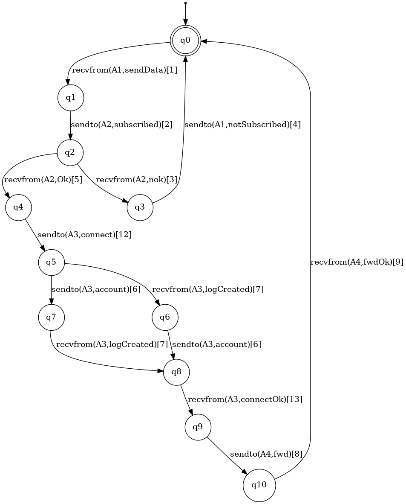 | 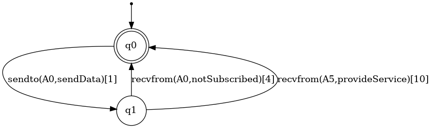 |
| 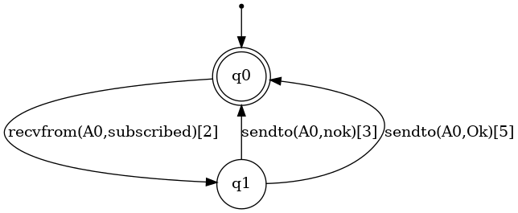 | 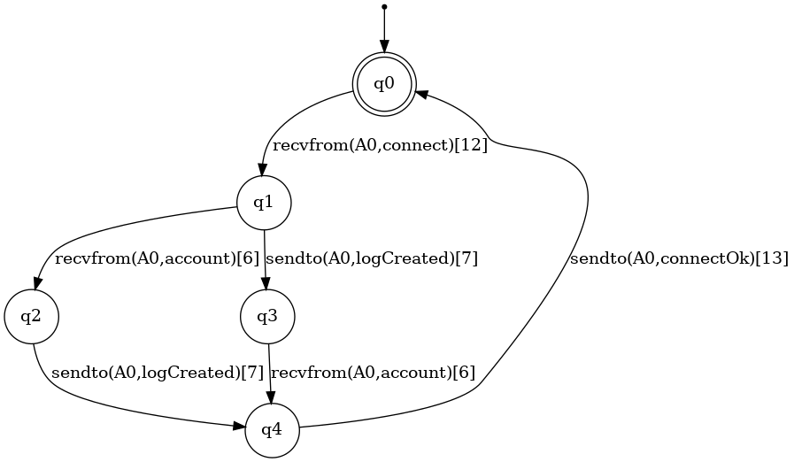 |
| 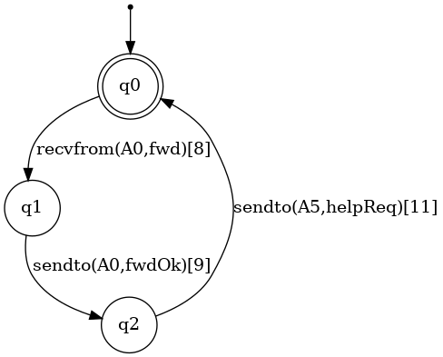 | 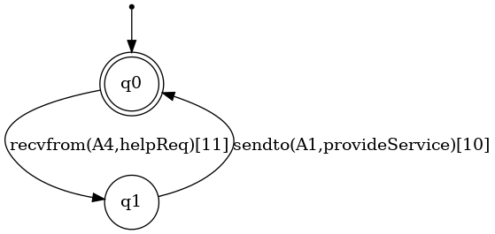 |


### Result with the method Petrify+Rewriting

By executing the command:

```
$ generalizer caut_composition caut_file.caut -p -v
```

we obtain the following results:


#### Local interactions

| Local Interactions | |
| :---: | :---: |
| 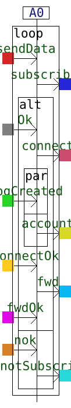 | 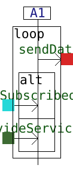 |
| 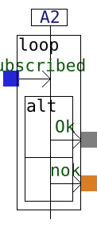 | 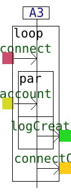 |
|  | 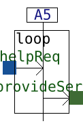 |

#### Global interaction

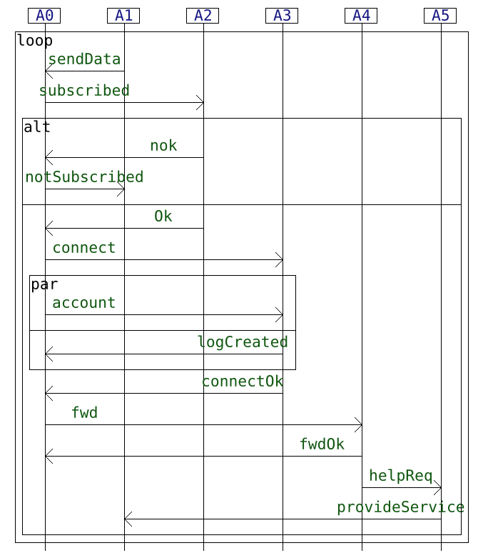

### Result with the method via Brzozowski's algorithm

By executing the command:

```
$ generalizer caut_composition caut_file.caut -b -v
```

we obtain the following results:


#### Local interactions

| Local Interactions | |
| :---: | :---: |
| 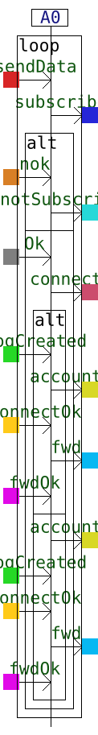 |  |
| 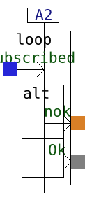 | 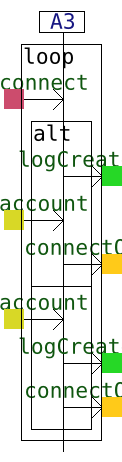 |
| 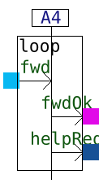 |  |

#### Global interaction

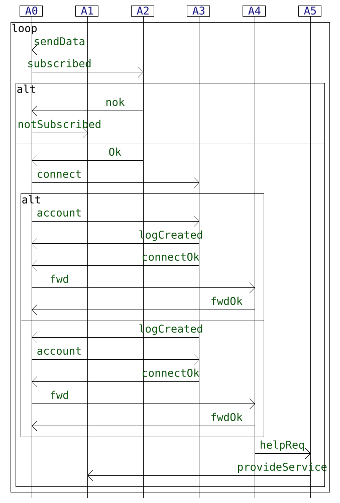