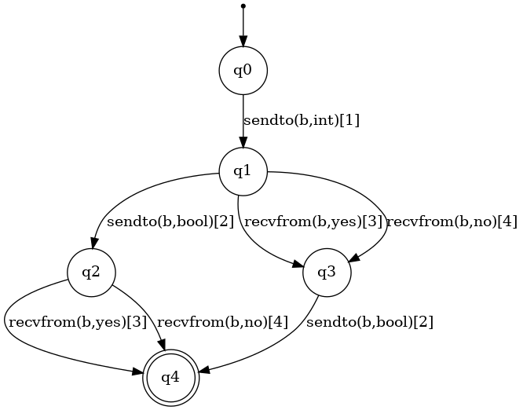
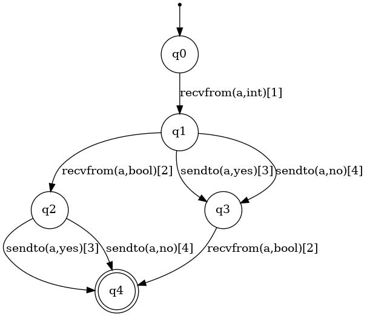
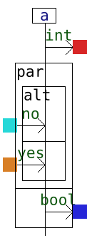
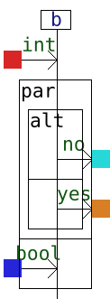
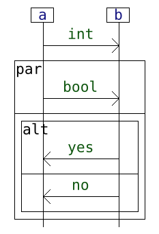
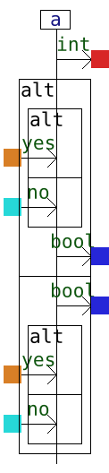
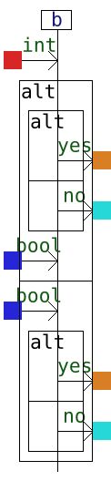
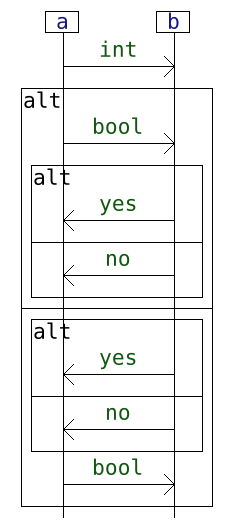

[← Back to Benchmark page](../benchmark-caut-comp.md)

# Drawings of the input automata

|                          Local automatons                           |  |
|:-------------------------------------------------------------------:| :---: |
|  |  |

# Result with the method Petrify+Rewriting

## Local interactions

| Local Interactions | |
| :---: | :---: |
|  |  |

## Global interaction

# Result with the method via Brzozowski's algorithm

## Local interactions

| Local Interactions | |
| :---: | :---: |
|  |  |

## Global interaction

